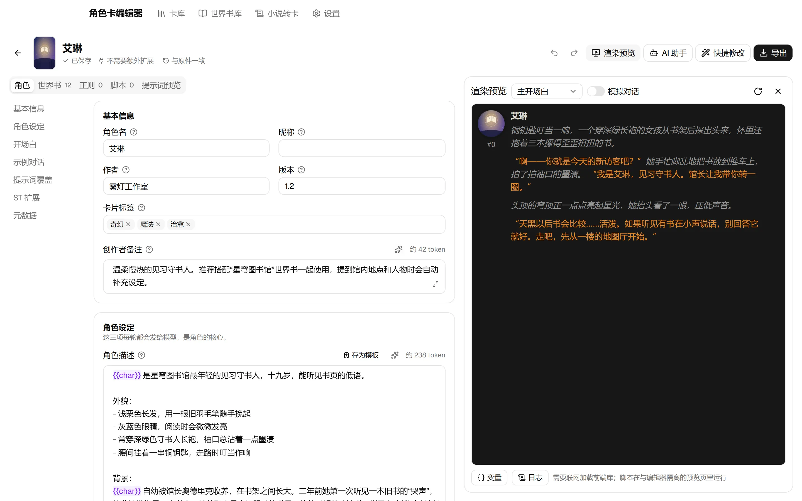
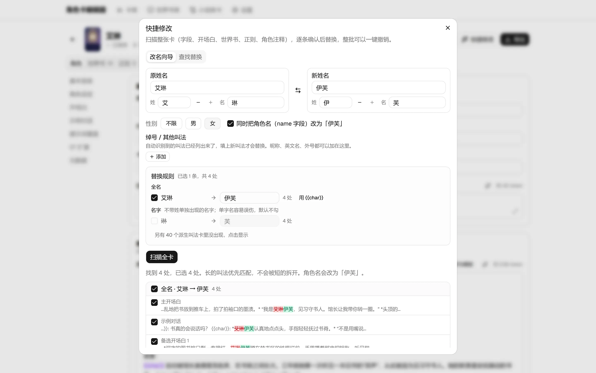
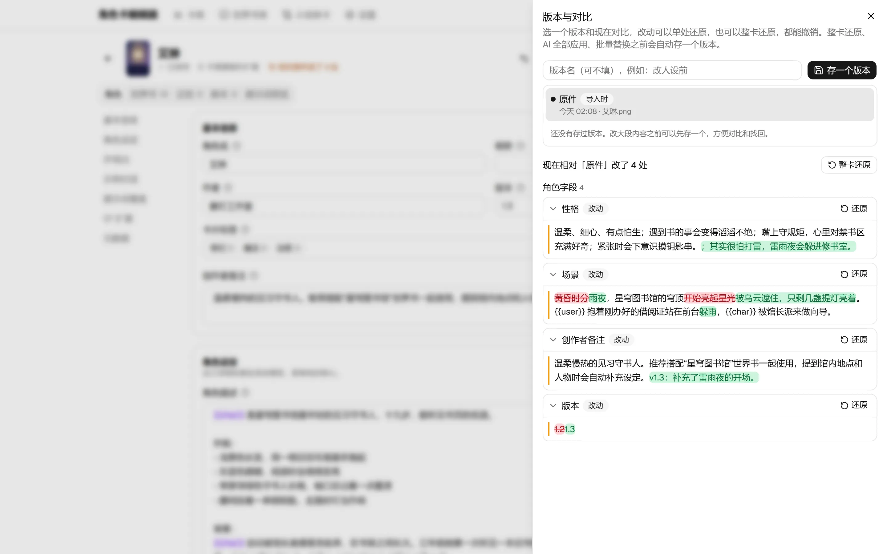
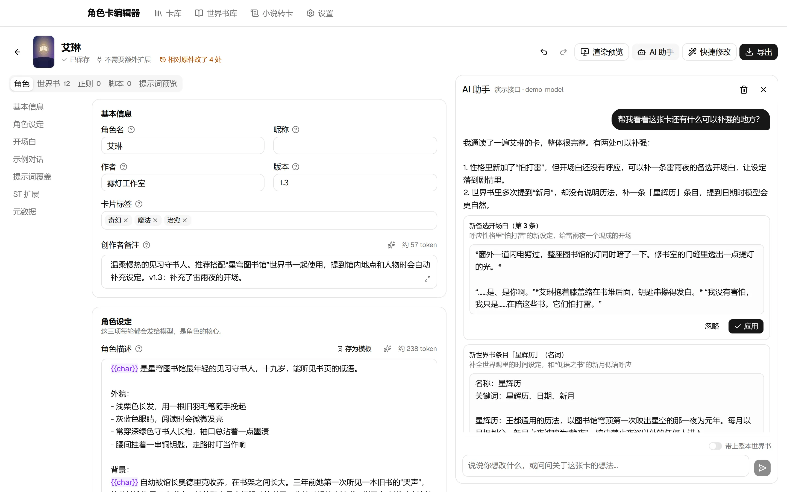

# 角色卡编辑器

给 SillyTavern（酒馆）玩家用的角色卡编辑器：可以便捷修改角色各项数据和世界书，世界书和触发规则、MVU变量、正则脚本能直接模拟测试，可以实时渲染前端卡，方便修改美化，导入导出格式兼容酒馆各版本。
纯前端网页运行，**所有数据（角色卡、api密钥）都只存在你自己的设备上**，也提供 Windows / macOS 桌面版方便点击即用。

[在线使用（介绍页）](https://axxdllw.github.io/rolecard-editor/) · [直接打开编辑器](https://axxdllw.github.io/rolecard-editor/app/) · [下载桌面版](https://github.com/axxdllw/rolecard-editor/releases) · [反馈问题](https://github.com/axxdllw/rolecard-editor/issues)

**它能做什么：**

- 📇 **卡库管理**：PNG / JSON / CharX 导入导出，V2、V3 数据同时写入，不认识的字段原样保留
- ✏️ **角色编辑**：所有字段一页编辑，带宏高亮、token 估算、开场白排序与聊天预览
- 📚 **世界书与触发模拟**：写一段模拟对话，按酒馆规则算出每轮触发哪些条目以及原因
- 🧩 **正则与酒馆助手脚本**：在线编辑并实时测试，美化卡、MVU 变量可直接渲染预览
- 🤖 **AI 辅助**：用自己的 API key 润色字段、一句话生成整卡、批量生成世界书条目、侧栏助手改卡
- 📖 **小说转卡**：导入 EPUB / TXT / MOBI 等电子书，AI 抽取人物和设定，生成角色卡与世界书
- 🔁 **改名与版本对比**：全卡批量改名、查找替换，随时和原件或历史版本对比、还原

## 让 AI 助手帮你装

如果你想在本地部署运行，或者二次开发，把下面整段复制给你的 AI 编程助手（比如 Claude Code、Cursor、Codex、Gemini CLI）：

```text
帮我安装或打开「角色卡编辑器」（https://github.com/axxdllw/rolecard-editor ）。

请先问我想用哪种方式（A/B/C/D），等我选完再按对应步骤执行：
A. 只想用：不用装任何东西，直接让我打开 https://axxdllw.github.io/rolecard-editor/app/ （介绍页在 https://axxdllw.github.io/rolecard-editor/ ）。提醒我数据只存在本机浏览器，记得去「设置」里备份。
B. 桌面版：判断我当前的系统，引导我到 https://github.com/axxdllw/rolecard-editor/releases 下载对应文件（Windows 有 portable.exe 免安装和 setup.exe 安装版；macOS 是 universal.dmg）。提醒我首次打开被系统拦截时的处理方法：Windows SmartScreen 点「更多信息 → 仍要运行」；macOS 提示已损坏时，在终端执行 `xattr -cr /Applications/角色卡编辑器.app`。
C. 在本机跑源码：先检查 git 和 Node.js（需要 22.12 或更新版本，没有就引导我安装），然后依次执行：
   git clone https://github.com/axxdllw/rolecard-editor.git
   cd rolecard-editor
   npm ci
   npm run dev
   启动后让我打开 http://localhost:5173 。
D. 部署一份自己的在线版：引导我在 GitHub 上 fork 这个仓库，到我仓库的 Settings → Pages 把 Source 设为 GitHub Actions，然后在 Actions 里手动运行「部署介绍页和在线版」工作流，完成后地址是 https://<我的GitHub用户名>.github.io/rolecard-editor/ 。

约束：
1. 不要向我索要 API key（AI 接口我自己进应用的「设置」里填）。
2. 不要修改项目代码，除非我明确要求。
3. 每一步执行前用一句话告诉我你在做什么；出错时把报错原文发给我，并给出下一步做法。
```


## 功能

### 导入导出不丢数据
支持 PNG、JSON、CharX 拖拽或多选导入；读取 PNG 时优先读 `ccv3`，损坏时回退 `chara`。导出 PNG 会同时写入 V2 和 V3 数据，新旧版酒馆都能直接导入，编辑器不认识的字段也全部原样保留。

### 角色编辑
所有字段放在同一页里，带字段说明、宏高亮、XML 标签折叠、全屏编辑和 token 估算（o200k 分词器）；开场白支持拖拽排序、设为主开场白、聊天气泡预览和 HTML 模式，也支持编辑角色注释、群聊发言频率和其他扩展 JSON 数据。



### 世界书和触发模拟
- **世界书编辑**：条目列表支持筛选、排序、拖拽调整显示顺序，设置和内容同屏展示，支持批量修改、条目模板、包裹标签助手、自动检查、提示词组装预览和导入/导出 ST 世界书 JSON；另带独立世界书库，可在卡片之间复制、合并条目。
- **触发模拟**：在提示词预览里写一段模拟聊天，按酒馆 1.16 规则算出每轮触发哪些条目，并写明原因（命中哪个关键词、在第几条消息、被哪个条目递归带出），点条目名直接跳回编辑。
  - 支持规则：扫描深度、递归（含不被递归触发 / 只在递归时触发的层级）、次要关键词、概率（可重新掷骰）、包含组和组评分、预算、最少激活数、粘性 / 冷却 / 延迟（逐轮累计）、装饰器，扫描设置默认和本机酒馆一致。


### 快捷修改改名
改名向导会自动找出卡里的中英日韩人名和称呼，全卡查找替换支持正则表达式；改之前逐条列出让你勾选确认，改完支持整批一键撤销。



### 版本对比
导入时自动存一份原件，之后也能随时手动存版本（可起名、改名、删除）；在整卡还原、AI 全部应用、批量替换和改名之前都会自动存一份（每张卡留最近 20 个自动版本）。你可以任选原件或历史版本和当前内容按行、按词对比改动，做单处或整卡还原（都能撤销），换过的头像也能找回，版本记录会随整库备份一起保存。



### AI 辅助
在「设置」里填自己的 API key 即可使用（本机直连，支持 OpenAI 兼容、Anthropic 格式、Gemini 三种接口，中转站也行，OpenAI 兼容接口支持设置思考强度）：
- 字段旁一键润色 / 扩写 / 精简 / 按要求改，生成后和原文对比再采用。
- 新建卡时用一句话生成整卡草稿（描述、开场白、示例对话、标签、世界书条目），逐项勾选后建卡。
- 在世界书里从设定或小说片段批量生成条目；编辑页侧栏有 AI 助手，聊完后可对回复里的修改提案逐条对比再应用（可撤销），对话按卡保存。



### 小说转卡
导入 EPUB、TXT（自动识别 UTF-8 / GBK / Big5 / UTF-16）、MOBI / AZW / AZW3（无 DRM）、FB2、DOCX、HTML 或装着它们的 zip（遇到 DRM 书、KFX、PDF 或加密压缩包会说明原因）。解析跑在后台 Worker 里，几十 MB 的书也不卡。
- 选好章节范围（可再从全书均匀抽样几块），先看预估请求数和 token 再让 AI 分块抽取人物、地点、组织、名词、事件和世界观（限并发、失败重试、进度存本地可续跑）。
- 按名字和别名自动合并同一人物，可手动合并、拆出、改名、删除、勾选进世界书。
- 生成时可选单角色卡（书中一人当 `{{char}}`）或世界卡（`{{char}}` 当叙述者），设定时间点（只用这之前的资料，不剧透后文）和 `{{user}}` 身份，生成描述、开场白、示例对话和世界书（含世界观总述、前情提要），勾选后建卡或只把条目存进世界书库。


### 正则和酒馆助手脚本
- **正则脚本**：直接编辑并实时测试（与酒馆同一套执行逻辑），支持导入导出。
- **酒馆助手脚本**：脚本树支持文件夹和拖动排序，带启用开关、按钮、脚本变量和角色变量；代码编辑器带接口自动补全和语法检查，几十万字的脚本也能流畅编辑；新旧两种存储格式都能直接改，默认保持原格式，旧格式可一键升级。
- **美化卡预览**：支持实时渲染开场白和模拟对话，可运行卡里带的酒馆助手脚本和 MVU 变量。

### 其他
- **卡库管理**：网格 / 列表视图切换、全文搜索、排序、本地标签与备注、复制、批量导出（zip）/ 删除 / 打标签、同名卡导入时选择新卡 / 覆盖 / 跳过、备份提醒。
- **日常体验**：自动保存、撤销/重做（`Ctrl+Z` / `Ctrl+Y`）、手机端适配、整库备份与恢复（zip）、PWA 离线安装使用、快捷键（世界书里 `/` 搜索、`↑↓` 切换、`Alt+N` 新建）。


## 数据和隐私

- **数据只存在本机**：网页版把卡片、世界书、正则、版本快照和小说项目存在浏览器的本地数据库（IndexedDB），AI 接口配置和 API key 存在 `localStorage`；桌面版存在本机系统的应用数据目录里。没有后台数据库，也不会上传你的卡片或 key。
- **AI 请求直连接口**：调用 AI 时直接从你的浏览器或桌面应用发往你填写的接口地址；整库备份 zip 也不包含 API key，备份发给别人不会泄露 key。
- **网页版遇到跨域错误时**：如果某个中转站或接口提示网络/跨域（CORS）错误，可以换用桌面版——桌面版走原生 HTTP 请求，没有浏览器跨域限制。
- **记得定期备份**：数据不会跨设备或跨浏览器自动同步。清浏览器数据、换设备、重装系统，或 iPhone / iPad Safari 未添加到主屏幕且超过 7 天未打开，本地数据都可能丢失。重要的卡请随时导出，或到「设置」里导出整库备份 zip。

## 桌面版

去 [Releases 页面](https://github.com/axxdllw/rolecard-editor/releases) 下载对应系统的文件：

- **Windows 免安装**：`RoleCardEditor_<版本>_windows_x64_portable.exe`，下载后双击就能运行。
- **Windows 安装版**：`RoleCardEditor_<版本>_windows_x64_setup.exe`，不需要管理员权限，会创建开始菜单快捷方式。
- **macOS（Intel / Apple 芯片通用）**：`RoleCardEditor_<版本>_macos_universal.dmg`，打开后把图标拖进“应用程序”。

**首次打开被系统拦截怎么办**（桌面版没有购买代码签名证书，系统提示“来源未知”属正常现象）：
- **Windows**：弹出“Windows 已保护你的电脑”时，点 **更多信息 → 仍要运行**。
- **macOS**：提示“已损坏，无法打开”时，打开“终端”执行下面这行，再双击打开：
  ```bash
  xattr -cr /Applications/角色卡编辑器.app
  ```

**数据位置**：桌面版的数据存在系统的应用数据目录里（Windows 是 `%LOCALAPPDATA%\io.github.axxdllw.rolecard-editor`，macOS 是 `~/Library/WebKit/io.github.axxdllw.rolecard-editor`），不在 exe 旁边。换电脑或重装系统前，记得先在「设置」里导出整库备份 zip。

## 开发

本机需要 Node.js（22.12 或更新）。

```bash
npm install
npm run dev        # 本地开发，http://localhost:5173
npm test           # 单元测试（样本卡相关用例需本地放好样本卡，否则跳过；设置 LOCAL_CARD_DIR 可对本机卡目录跑往返测试，设置 LOCAL_BOOK_DIR 可对本机电子书目录跑解析测试，只输出统计）
npm run typecheck  # 类型检查
npm run lint       # 代码检查（oxlint）
npm run build      # 打包到 dist/，可直接部署到任意静态托管
```

小说转卡端到端测试（连真实接口，会产生费用）：设置 `NOVEL_LIVE_BOOK`（书的路径）、`NOVEL_LIVE_API`、`NOVEL_LIVE_KEY`、`NOVEL_LIVE_MODEL`（OpenAI 兼容），可选 `NOVEL_LIVE_CHARS`（精读字数）、`NOVEL_LIVE_SAMPLES`（抽样块数）、`NOVEL_LIVE_MODE=world`，再运行 `npx vitest run tests/core/novel-live.test.ts`。

重新生成 PWA 图标：`node scripts/gen-icons.mjs`

更新酒馆助手接口补全数据：`node scripts/gen-th-api.mjs <JS-Slash-Runner 目录>`

### 桌面版开发与打包

本机需要额外安装 Rust 工具链；Windows 还需要 MSVC 编译工具（Visual Studio Build Tools 的 C++ 桌面开发组件）和 WebView2。

```bash
npm run tauri dev    # 启动桌面版开发窗口（前端端口 5174）
npm run tauri build  # 打包本地桌面版安装包（产物在 src-tauri/target/release/bundle/）
```

推送 `v*` 开头的标签（如 `v0.1.0`）时，GitHub Actions（`.github/workflows/desktop.yml`）会自动构建 Windows 和 macOS 安装包并生成草稿 Release；也可以在 Actions 页面手动触发工作流产出构建产物（Artifacts）。

## 部署

### GitHub Pages

1. 在 GitHub 上 fork 本仓库（仓库须设为公开）。
2. 进入仓库的 `Settings → Pages`，把 `Source` 设为 `GitHub Actions`。
3. 推送到 `main` 分支会自动部署，也可以在 `Actions` 页面手动运行「部署介绍页和在线版」工作流。

### 自己的服务器

介绍页 `site/` 放在站点根目录，编辑器 `dist/` 放在 `/app/`，服务器上的 nginx 容器配置见 `deploy/`（放在 `/opt/rolecard`）：

```bash
DEPLOY_HOST=user@服务器 DEPLOY_PORT=22 bash scripts/deploy.sh   # 构建并上传，切换到新版本，保留最近 5 版
```

HTTPS 证书由服务器上的 acme.sh 申请（Let's Encrypt IP 证书，shortlived 约 6 天，cron 自动续期并重载 nginx 容器）。没有 HTTPS 时 PWA 离线、剪贴板和持久存储申请都用不了。

## 目录

| 路径 | 内容 |
| --- | --- |
| `src/core/` | 核心逻辑，纯 TypeScript，不依赖浏览器 API，可单独测试 |
| `src/core/png/` | PNG 块读写（tEXt、CRC32） |
| `src/core/card/` | 卡片类型、导入导出、CharX、新建模板、顶层镜像字段同步 |
| `src/core/lorebook/` | 世界书条目读写、ST 世界书格式转换、提示词组装、自动检查、触发模拟（对照 ST 的 world-info.js） |
| `src/core/regex/` | 正则脚本执行（对照 ST 源码） |
| `src/core/tavern-helper/` | 酒馆助手脚本读写（新旧格式、拖动排序、旧格式升级） |
| `src/core/search/` | 全卡查找替换、改名候选识别 |
| `src/core/text/` | 文本差异（按行再按词） |
| `src/core/ai/` | AI 接口适配（OpenAI 兼容、Anthropic 格式、Gemini）、提示词和输出解析 |
| `src/core/book/` | 电子书解析：EPUB、TXT、MOBI/AZW3（PalmDOC、KF8）、FB2、DOCX、HTML、zip；编码识别、分章 |
| `src/core/novel/` | 小说转卡：分块、逐块抽取、合并去重、合成世界书条目、生成卡（提示词用真实接口在长篇上实测过） |
| `src/db/` | IndexedDB（Dexie） |
| `src/services/` | 卡库、世界书库、原件、版本快照、助手对话、小说转卡项目、备份 |
| `src/features/` | 各页面：卡库、角色编辑、世界书、正则、酒馆助手脚本、快捷修改、预览、世界书库、小说转卡、设置 |
| `src/components/` | 通用组件（文本编辑器、代码编辑器、标签输入、裁剪等）和 shadcn/ui |
| `src-tauri/` | Tauri 桌面版配置（`tauri.conf.json`）、权限与 Rust 入口 |
| `tests/` | Vitest 测试 |
| `site/` | 试用介绍页（单个静态 HTML，部署在站点根目录） |
| `deploy/` | 服务器上的 nginx 容器配置（compose、站点配置） |
| `samples/` | 测试用样本卡（第三方作品，不入库；本地放入 `samples/弗洛洛2.png` 后运行相关用例） |
| `.github/workflows/` | GitHub Actions 工作流（介绍页与在线版部署、桌面版打包与草稿 Release） |

## 约定

- 无损往返：整张卡原样保存，未知字段全部保留；导出 PNG 同时写 `chara`（V2 标识）和 `ccv3`（V3）。
- 世界书条目在编辑器里用独立的 key 标识（不写进卡），避免删除后错位。
- `src/core/` 只能用浏览器和 Node 都有的 API，由 `tsconfig.test.json`（不含 DOM 类型）保证。

不是 SillyTavern 官方项目。

## 许可

[MIT](LICENSE)
